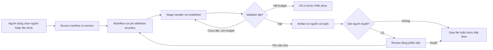

# Kế hoạch hoàn thiện sản phẩm

> Cập nhật 18/10/2026 (nghiệm thu nội dung HR đã đạt). Revision qua UI sau bản sửa đã
> **PASS kiểm tra nội dung độc lập**: báo cáo tiếng Việt không lẫn ký tự ngoại lai, mọi
> finding khớp nguyên văn nguồn, câu giới hạn L2 nêu rõ quyết định nhân sự thuộc con người,
> file DOCX tải được từ UI. Campaign hậu-sửa riêng cap 8 dùng 6/8 lượt `:free`; chi phí
> báo cáo 0, usage chưa biết giữ unknown; ledger cũ không đổi. Gate đầy đủ: lint/typecheck
> PASS, 4282 test PASS (một test `advisory-lock` flaky PASS khi chạy lại), 35 E2E PASS,
> nguồn không đổi. Kèm đó: task analysis tự do đính kèm file dùng báo cáo trích dẫn; tải
> câu trả lời Markdown; nhận CV trực tiếp sau duyệt rubric; định danh ứng viên bằng SHA-256.
> Nghiệm thu end-to-end SOP tuyển dụng ngoài MEP và nhận CV qua UI vẫn là bước kế tiếp
> (cần dữ liệu tổng hợp được phép + cổng người duyệt), chưa tuyên bố tuyển người thật.

> Cập nhật cục bộ 18/10/2026, **PARTIAL, chưa commit/push**. Đã nối task HR tự do
> với file upload qua báo cáo có trích dẫn; tải câu trả lời Markdown; nhận CV trực tiếp
> sau duyệt rubric; dùng SHA của CV xuyên suốt phỏng vấn/chọn ứng viên; chuyển API
> khỏi bộ đếm nghiệm thu sang `make serve` có xác minh PID/cổng/readiness. Sửa lỗi
> runtime làm mất lý do revision và thông tin bổ sung trước khi gửi model.
> Gates-4 mới: lint/typecheck PASS, **4280 test + 35 E2E PASS**, 618 hash nguồn khớp.
> Trình duyệt thật đã kiểm tra upload/báo cáo DOCX/tải Markdown. Nhận CV dùng fixture
> tổng hợp có các bước trước chuẩn bị bằng máy, không phải duyệt hay tuyển người thật.
> **Nghiệm thu nội dung HR chưa đạt**: báo cáo model có chữ Trung Quốc và câu diễn giải
> quyền AI chưa làm rõ quyết định nhân sự thuộc con người. Citation đúng không bảo đảm
> diễn giải đúng. Lượt sửa sau gặp usage sai/deadline và giới hạn campaign 8/8; không
> nới giới hạn. Campaign riêng mới tối đa 4 lượt kiểm chứng bản sửa feedback đã xác nhận
> feedback tới cả 4 request OpenRouter thật; nhưng DOTS trả finish_reason=error hai lần,
> Nvidia quá tải 503 hai lần, không có artifact được chấp nhận. Campaign mới đóng 4/4,
> không gộp thành PASS nội dung; chi phí/usage chưa biết vẫn giữ unknown.
> Bằng chứng chỉ giữ cục bộ tại `.orchestra/hr-system-completion-2026-10-18/`;
> `final-status.json` và `CONTINUE_SYSTEM_FINAL.txt` ghi kết quả và việc tiếp theo.
> Chỉ commit/push sau khi revision qua UI đạt kiểm tra nội dung độc lập. SOP vẫn là
> MEP và còn các cổng người duyệt, chưa phải quy trình tuyển dụng hoàn tất.

> Cập nhật 17/10/2026 (nghiệm thu HR qua UI, gates-6): **retry task HR ordinary qua UI PASS**
> (giữ owner HR, giữ clarification, task cũ vẫn failed bất biến, Run tường minh, kết quả
> render + đọc toàn văn + copy) và **workflow SOP tuyển dụng qua UI** chạy tới JD rồi dừng ở
> **jd_review chờ người duyệt** (đủ sáu mục; DOA CHƯA XÁC ĐỊNH cần Boss/HR; KPI là ĐỀ XUẤT;
> không có trọng số rubric; review nội dung độc lập PASS). **Không phải tuyển dụng hoàn tất**:
> chỉ JD → người duyệt, không có ứng viên/offer/quyết định nhân sự thật. Gates-6: **lint PASS;
> typecheck PASS; make test 4256 PASS; E2E 35 PASS**, hash source không đổi trong lúc chạy.
> Sửa gốc: `task_retry.py` chỉ giữ owner khi `source_workflow` → nay giữ owner cho mọi retry;
> validator output không còn từ chối envelope xin duyệt trên task có hợp đồng trích dẫn; khôi
> phục câu "missing key is a failed run" trong prompt. Bằng chứng cục bộ tại
> `.orchestra/hr-ui-acceptance-2026-10-18/` và `.orchestra/hr-ui-sop-2026-10-18/` (không công
> bố); báo cáo lọc tại
> [artifacts/hr-ui-acceptance/2026-10-18/summary.json](artifacts/hr-ui-acceptance/2026-10-18/summary.json).
> Giới hạn giữ nguyên: SourceManifest upload dạng ordinary task vẫn unsupported; `write_report`
> chỉ trả lời inline, chưa có artifact download; ca âm cũ kiểm offline; provider free chập chờn.

> Cập nhật 16/10/2026 (MuseSpark continuation, gates-c4): task đơn ordinary 7/7 PASS
> trên PydanticAI runtime thật (DOTS, cost 0, DB kiểm chứng độc lập); chain
> CEO→office→department PARTIAL — round 3 đã tới leaf completed + grade PASS
> nhưng chưa có vòng settlement hoàn tất (round 1/2/4/5 FAIL trung thực, giữ
> receipt). Gates-c4: lint/typecheck/4151 test/35 E2E PASS cùng source hash.
> Baseline đã kiểm tra: 3.870 test, 35 E2E, lint/typecheck PASS; UI trên cổng 8100
> đã qua 91 kiểm tra điều hướng và 30 kiểm tra nút/phông chữ. Đây là bằng chứng
> của đợt trước, không thay cho campaign model thật: chưa đạt nghiệm thu.
> [Báo cáo công bố đã lọc dữ liệu](artifacts/product-completion/2026-10-16-openrouter/summary.json).
> Sửa 200-envelope: HTTP 200 mang error.code 503 được phân loại đúng (fallback được, giữ terminal 401/refusal, không bịa usage); 5 regression MockTransport; harness campaign giữ local, chưa nghiệm thu.
> Các đường dẫn bằng chứng cục bộ trong nhật ký bên dưới không được phát hành lên Git.

> Nhật ký đợt trước, 16-10-2026 (giờ Việt Nam): OpenCode đã chuyển sang
> session mới dùng `opencode/longcat-2.5-preview-free`; ngừng dispatch Nemotron.
> Giữ nguyên model chạy tác vụ sản phẩm. Codex kiểm chứng thêm identity/token/operator
> CLI và quota source+artifact: **51 PASS** (17,69 giây); đây là focused suite,
> chưa thay thế full gate sau các sửa UI. Hai worker Longcat thực sự chạy song song:
> recovery preview (C) và audit pilot60 (D); nhóm UI/browser đang được điều phối.
> Pilot60 đã có đủ60 attempt, artifact đạt32/48 model case (66,7%), không đạt
> ngưỡng90%; 44/60 expectation có gồm12 negative guard. Chưa có expert ký duyệt.
> Evidence đợt này đang giữ riêng tại `.orchestra/longcat-2026-10-16/`; chưa công bố
> receipt cuối, chưa coi thay đổi đang viết hoặc báo cáo agent là đã nghiệm thu.

> Cập nhật triển khai 15-10-2026: xem [SOURCE_WORKFLOW_STATUS.md](SOURCE_WORKFLOW_STATUS.md)
> cho luồng nguồn/mock, upload, executor và export đã viết, giới hạn và bằng chứng.
> Chuỗi execution hiện hành: NVIDIA Nemotron Ultra free → DOTS free; Ling/Inkling
> trong các snapshot bên dưới là lịch sử, đã bị thay thế. Các số test cũ không
> thay cho cổng kiểm chứng của thay đổi nguồn hiện tại.

Rà soát ngày 15-10-2026, giờ Việt Nam. Đây là định hướng triển khai và cổng nghiệm
thu, không phải danh sách tính năng đã hoàn thành. Phạm vi mặc định là nền tảng
điều hành công việc cho doanh nghiệp, dùng O-Nexus làm tenant thí điểm rồi mở rộng
bằng gói cấu hình ngành. Giữ PydanticAI, Temporal và PostgreSQL hiện có.

## Delta triển khai trên main, 15-10-2026

Trạng thái chi tiết theo ID/owner/dependency tại [SOURCE_WORKFLOW_STATUS.md](SOURCE_WORKFLOW_STATUS.md).
Nguồn hiện hành là main baseline `a50f912`; `docs/` chỉ đọc và các snapshot cũ
phía dưới giữ để đối chiếu. **lint PASS; typecheck PASS; make test **3723 PASS**; E2E **35 PASS**.** [Gate6](artifacts/product-completion/2026-10-15-main/gates-final-6/receipt.json).

- Đã kiểm chứng: clean install hai DB rỗng/register idempotent; source API19 tests;
  revision terminal root giữ lịch sử và không copy approval/output/spend; event17
  focused; runtime23/9pages; UI42 checks mỗi desktop/mobile và fix banner waiting-input.
- R2-REVIEW-01: CLI thực hiện packet8/8 từ run đã có và checklist0/60 chưa chạy.
  Codex sửa ledger unknown, round/denominator, duplicate, failed artifact claims,
  relocation/path và CSV provenance;57 unit PASS. Expert fields luôn UNREVIEWED.
- HARNESS-R2-DELTA-01:28 unit PASS; probe thật42/viewport PASS; ngắt giữa chừng
  ghi FAIL/exit1 với25 partial checks thay vì false-PASS. Giữ before/after receipt.
- R2-CORP-01:60ca tổng hợp đóng băng,30 mỗi workflow; offline PASS, live NOT_RUN.
  V2 tám ca giữ hash cũ; không nhập kết quả tám ca thành60ca đã chạy.
- R0-HLD-01: **FAIL** real-model holdout:7/8 expectations gồm2 negative guards,
  chỉ5/6 model attempts có artifact=83.3%, dưới ngưỡng đề xuất90%. qc-injection
  không gọi tool bắt buộc sau5 submissions; human expert review còn PENDING.
- Kiểm tra độc lập OpenCode sau các sửa integrity cuối của Codex **BLOCKED** bởi
  FreeUsageLimitError429 (4 worker + một bounded retry lỗi). Test/đọc lại do Codex
  không được gắn nhãn kiểm tra độc lập OpenCode. Các vòng độc lập trước giữ scope riêng.
- WTR-01 SKIP vì23e2 đã mất; WTR-02 PASS: process giữ6737 đã kết thúc,
  64 file/hash đã giữ; Git bundle phục hồi được verify, rồi Git remove không force.
  Retirement receipt (bằng chứng cục bộ: `artifacts/product-completion/2026-10-15-main/worktree-retirement-final.json`). Main HEAD không đổi.

Gói hiện hành (bằng chứng cục bộ: `artifacts/product-completion/2026-10-15-main/README.md`); expert packet8 (bằng chứng cục bộ: `artifacts/product-completion/2026-10-15-main/final-closeout/review-packet-root-actual-8-relocated/packet.md`);
checklist60 (bằng chứng cục bộ: `artifacts/product-completion/2026-10-15-main/final-closeout/review-packet-root-not-run-60/packet.csv`).
Các code/test đều trên main, chưa commit/push; dist giữ nguyên và docs/ không sửa.

Thứ tự tiếp: khôi phục năng lực OpenCode để kiểm độc lập bản integrity cuối →
R0 quality/reliability và expert review → pilot60 có nghiệm thu → R3 tenant/identity
→ connector canary. Checkpoint revision, identity/membership, quota/retention/storage
và connector vẫn MISSING/NOT_IMPLEMENTED; không coi mọi backlog là provider-blocked.

## Trạng thái hiện hành sau kiểm chứng agent ngoài

> Lịch sử trước batch cuối trên main; xem trạng thái hiện hành ở đầu file.

Cập nhật 15-10-2026: sidebar có gate mới 111 checks/31 ảnh; focused backend 115
pass; shell gate 195, runtime 23 và work gate 131 pass. Full suite 3560/E2E 34 đã đối chiếu log
của vòng agent trước, không ghi thành lần chạy mới. Probe live mới **1/2**,
ca nguồn bị provider content filter: R0 reliability vẫn mở. Backlog snapshot mới
209 phi-terminal, 0 running. Bằng chứng và lỗi còn mở tại
[SOURCE_WORKFLOW_STATUS.md](SOURCE_WORKFLOW_STATUS.md).

Các gap fixture/seed và upload ở phần snapshot bên dưới đã có sửa và regression
trong vòng source-intake; các mục identity, connectors, tenant pilot và SaaS vẫn
chưa nghiệm thu. Thứ tự tiếp theo là reliability/quality → source revision và
review → tenant/identity → connector canary → mở rộng workflow pack.

## Snapshot trước triển khai source-intake, giữ để đối chiếu

Snapshot tenant còn 224 task chưa terminal và không có execution running:
11 root chưa kết thúc có cả fixture/campaign thử nghiệm, 199 assigned children dưới parent assigned hoặc chờ input,
14 approval children dưới parent đã failed. Nhóm cuối cần thu hồi/reconcile đúng
phạm vi campaign; không tự approve hoặc coi failed/canceled là công việc thành công.
Số liệu và giới hạn mẫu nằm trong [task-backlog.json](artifacts/product-review/2026-10-15/task-backlog.json).

Sản phẩm có nền thực thi và quản trị đáng kể, nhưng chưa phải bộ ứng dụng doanh
nghiệp hoàn chỉnh. Điểm thiếu lớn nhất nằm ở đường đi của công việc: lấy đúng nguồn,
chuyển thành dữ liệu có thể kiểm chứng, xử lý qua các bước, giao file dùng được,
nhận quyết định con người và đồng bộ kết quả về hệ thống nghiệp vụ.

Ba gap cần giữ trong cổng R0: test forbidden-zone hiện bỏ qua vì tenant fixture
chưa được seed process spine; hai test delegation-view bỏ qua do không tạo hoặc
publish delegation trong fixture; clean-install chưa tạo đủ register roles. Các
bài governance/delegation khác có chạy, nhưng không thay thế ba assertion bị bỏ
qua này. Cần sửa fixture bằng nguồn seed đúng và tạo event qua publisher thật,
không đổi skip thành pass bằng assertion trên chuỗi source.

Bằng chứng mới nằm tại [product-review](artifacts/product-review/2026-10-15/).
[Inventory chạy lại được](scripts/inventory_product_surface.py) ghi 123 route
khai báo và hash source; số route không được xem là số tính năng đã nghiệm thu.

- `domain/business_workflow.py` có hai chuỗi bước chuyên biệt: MEP hiring và
  procurement. `domain/hr_templates.py` có bốn template HR: recruitment,
  performance, payroll, offboarding. Ba template HR sau không đồng nghĩa đã có
  controller nghiệp vụ, connector và bằng chứng vận hành tương đương tuyển dụng.
- Playbook SOP, agent blueprint và task tổng quát mở rộng được cách giao việc;
  mỗi cách vẫn cần nguồn, validator và đầu ra tương ứng để thành workflow tin cậy.
- Documents API có register/version/distribution/acknowledgement. Chưa có đường
  upload đa định dạng → OCR/parser → manifest chọn nguồn → task → download thống nhất.
- `safe_web_search` hiện trả fixture. `document_reader` đọc text từ kho nội bộ;
  không suy ra rằng nó đọc được mọi file. SMTP/IMAP tuyển dụng, MCP và A2A đã có
  boundary cụ thể, chưa phải marketplace connector doanh nghiệp.
- JWT, password hashing và principal đã có. Chưa có vòng đăng nhập, membership,
  thu hồi phiên, SSO và quản trị quyền hoàn chỉnh trong sản phẩm. Demo dùng tenant
  header với auth tắt; không coi đó là nghiệm thu đa tenant production.
- Setup DB mới tạo được demo và process spine nhưng `seed-test-reference` thất bại
  vì thiếu role catalogue đầy đủ cho register. Suite lần này dùng lại catalogue
  đang có trong cluster gốc; không che khoảng trống clean-install này bằng seed tay.

Task HTTP mới đã hoàn thành đúng phép so báo giá và lưu model thực tế sau khi sửa
bridge. Benchmark mới cho thấy Inkling vẫn bị 403, Ling free không còn trong
catalogue, DOTS đạt 2/3 ca. Chuỗi ưu tiên do người dùng chọn vẫn được giữ; chưa có
bằng chứng chuỗi free hiện tại đáp ứng SLA sản phẩm. Kết quả ngày 07-10 được giữ
riêng để truy vết, không dùng làm trạng thái hiện tại.

### Cổng kiểm chứng đã chạy lại ngày 15-10-2026

`make lint` và `make typecheck` đạt. `make test`: **3.508 passed, 3 skipped,
1 deselected**, 10 cảnh báo parser Excel. `make test-e2e`: **34 passed**, preflight
PostgreSQL/NATS/Temporal đạt. Regression tập trung bridge/fallback: **44 passed**.
Ba skip vẫn là gap đã mô tả, không tính là đạt. Hai task HTTP dùng model thật với
input tổng hợp đều completed; probe thứ hai đối chiếu cả execution và usage ledger.
[Receipt tổng hợp](artifacts/product-review/2026-10-15/review-results.json) giữ
command, kết quả, hash bằng chứng và danh sách việc còn mở.

## Phạm vi sản phẩm cần có

| Nhóm | Đã có nền | Phần cần hoàn thiện | Điều kiện giao được |
| --- | --- | --- | --- |
| Workspace công việc | Task, delegation, detail, SSE, approvals | Dự án/case, inbox chờ tôi, intake có kiểu, tìm kiếm, saved views, comments/mentions, thông báo và nhắc hạn | Người dùng biết đang chờ ai, thiếu gì, nhận sản phẩm ở đâu |
| Nguồn và kho tài liệu | Document control, memory/provenance, mail attachments | Upload/resumable, ZIP, OCR, file version, preview, source picker, quyền, retention | Chọn nguồn hoặc tạo file mock rõ ràng; chỉ dùng nguồn trong manifest |
| Đầu ra | JSON artifact, report text, execution records | Artifact service và download, DOCX/XLSX/PDF/ZIP, template, citation, diff/review | File tải và mở được, số liệu khớp nguồn, có version/hash |
| Workflow | Hai controller, blueprint, SOP, gate/revision/recovery | Definition/version, trigger, schedule, branching, parallel join, timeout, reusable subflow, sandbox | Chạy lại/restart không mất tiến độ hoặc nhân đôi tác động |
| Agent và model | Profiles, gateway, tool contracts, budgets | Capability/entitlement health, model policy theo loại việc, context compression, concurrency và cost dashboard | Output hỏng được repair/fallback; hết giới hạn báo lỗi có hướng xử lý |
| Tri thức | Tenant/unit scope, chunk citation, lexical/hash retrieval | Parser-aware chunks, hybrid retrieval/rerank nếu đo thấy cần, feedback chất lượng | Đo recall và grounding trên corpus tenant; không lẫn tenant |
| Người duyệt | Approval packet, maker-checker ở một số đường, pause/revision | Inbox thống nhất, delegation quyền có hạn, expiry, thông báo, signed artifact version | Duyệt đúng payload/version; sửa nguồn làm mất hiệu lực approval cũ |
| Connector | Mail tuyển dụng, HTTP tool, MCP, A2A, action receipts | OAuth connections theo tenant, Gmail/Drive trước, cursor, revocation, webhook, read-back | Thử canary read-only rồi từng write action có kiểm chứng |
| Học và chất lượng | Draft SkillVersion, train/holdout và publication gate | Dataset registry, failure taxonomy, eval theo workflow/model, canary/rollback | Candidate phải có cải thiện đo được; không tự publish từ simulation |
| Tenant và quản trị | RLS, org/unit, definitions, policies | Login/membership/RBAC, provisioning, template pack, custom fields, localization, secret vault | Hai tenant cấu hình khác nhau chạy chung runtime, không lẫn dữ liệu/quyền |
| Vận hành | Native stack, health/readiness, logs, migration/tests | One-command setup đủ catalogue, durable dispatch/worker heartbeat, restore drill, observability, deployment/replay, quota | Cài từ DB rỗng, phục hồi backup và xử lý worker crash có receipt |
| SaaS thương mại | Chưa nghiệm thu | Usage metering, quota, billing nếu bán SaaS, support/admin, export/delete | Metering đối soát được; chính sách dữ liệu và hỗ trợ rõ ràng trước mở bán |

## Thiết kế để tăng workflow mà không nhân đôi hệ thống

Ba lựa chọn được cân nhắc:

| Lựa chọn | Lợi ích | Giới hạn | Kết luận |
| --- | --- | --- | --- |
| Viết thêm controller riêng như hiện tại | Ra nhanh cho một SOP | Mỗi workflow lại thêm intake, recovery, audit và UI; khó tùy chỉnh tenant | Dùng cho logic chuyên ngành khó, không làm mặc định cho mọi workflow |
| Cho agent tự phát sinh và chạy flow tùy ý | Linh hoạt về mô tả | Khó chứng minh điểm dừng, nguồn, tác động và khả năng nâng phiên bản | Chỉ cho đề xuất blueprint trong sandbox và duyệt trước áp dụng |
| Definition có kiểu + runtime dùng chung + handler chuyên ngành | Tái dùng thực thi; pin version; tenant override có kiểm tra | Cần contract và lộ trình migrate rõ ràng | Hướng được đề xuất |

Luồng mục tiêu khi các mốc đã được triển khai:

Một `WorkflowDefinitionVersion` cần có input/output schema, source requirements,
stages, dependency graph, validator references, human gates, allowed tool scopes,
budget/timeout, artifact templates và owner mapping theo role. `WorkflowRun` pin
phiên bản definition, source manifest, skill/model policy và actor. Mỗi stage có
input/output reference, attempt, trạng thái, receipt, lỗi có kiểu và recovery policy.

Stage type đầu tiên: input, extract, deterministic transform, model, validate,
human gate, connector action, artifact render. Chỉ thêm branch và parallel join khi
có workflow dùng thật và quy tắc failure/cancellation rõ. Definition là dữ liệu có
schema; tenant không tải mã Python/JS tùy ý vào worker. Validator nghiệp vụ là
extension có version và test. Phép tính tiền, điểm, đơn vị và điều kiện hợp lệ
thuộc code xác định; model trích xuất, soạn thảo và giải thích có nguồn.

Workflow cần ghi dữ liệu nghiệp vụ phải gọi command có kiểu, kiểm tra quyền,
idempotency và ghi receipt/event. Không biến tool SQL read-only thành quyền ghi
SQL tự do. Ví dụ invoice matching tạo exception/payment proposal; ghi sổ hoặc
thanh toán là command/connector riêng với quyền và approval phù hợp. Hệ thống có
thể điều phối ERP/CRM hiện hữu; không cần viết lại toàn bộ sổ kế toán hay BIM
trước khi giao được báo cáo và hồ sơ dùng được.

Database tiếp tục giữ task/execution/receipt. Temporal sở hữu scheduling và retry
trên durable path; activity gọi executor chung. Native controller hiện tại giữ
recovery owner hiện tại cho đến khi có migration cụ thể. Không để hai scheduler
đồng thời điều khiển một run. Local runner vẫn là chế độ phát triển, không cam kết
khôi phục sau khi process mất. UI phải cho thấy execution mode.

Không triển khai thay controller hàng loạt trong lần rà soát này. Trước mỗi đợt
migrate phải có adapter, diff contract, replay/recovery test và đường rollback,
trình người dùng duyệt phạm vi refactor cụ thể. Temporal yêu cầu tính deterministic
và hướng dẫn replay testing trước triển khai code mới; đây là lý do bổ sung cổng
replay, không phải lý do đổi framework. [Nguồn Temporal](https://docs.temporal.io/develop/safe-deployments).

## Danh mục workflow mục tiêu

Bảng này là backlog thiết kế. Ngoài hai chuỗi đã nêu và các template hiện có,
không có workflow nào dưới đây được tuyên bố đã hoàn thành. Mỗi hàng có thể chia
thành nhiều phiên bản theo ngành; chưa làm visual builder trước khi contract ổn.

| Đợt | Workflow hoặc nhóm workflow | Nguồn chính | Sản phẩm và điểm quyết định |
| --- | --- | --- | --- |
| A | Đọc hồ sơ, tóm tắt và hỏi đáp có nguồn | PDF/DOCX/ảnh/ZIP từ kho được chọn | Báo cáo có vị trí trích dẫn; thiếu chứng cứ phải chỉ rõ |
| A | So sánh báo giá và kiểm chứng NCC | BOQ, báo giá XLSX/PDF, chứng chỉ | Bảng đủ điều kiện, giá chuẩn hóa, danh sách thiếu; người phụ trách duyệt |
| A | Tuyển dụng đến onboarding | Brief, CV, rubric, phỏng vấn, offer và xác nhận thật | Shortlist/scorecard/JD/offer draft/checklist; quyết định nhân sự do người duyệt |
| A | Kiểm tra bộ hồ sơ MEP | Yêu cầu kỹ thuật, submittal, checklist, chứng chỉ | Ma trận đủ/thiếu/sai lệch và RFI draft; không tự kết luận an toàn |
| B | Đánh giá hiệu suất và kế hoạch phát triển | KPI, kết quả, phản hồi có quyền | Evidence-based scorecard và kế hoạch; người quản lý chốt |
| B | Đối soát timesheet/payroll | Chấm công, chính sách lương đã duyệt | Bảng đối soát và exceptions; không tự thanh toán |
| B | Offboarding và bàn giao | Quyết định có thẩm quyền, tài sản, tài khoản | Checklist/handover; thu hồi quyền qua connector cần phê duyệt |
| B | AP và đối chiếu ba bên | PO, GRN, invoice | Match/exception/payment proposal; người có thẩm quyền duyệt |
| B | AR và theo dõi công nợ | Hợp đồng, nghiệm thu, invoice và lịch thu | Aging/cash forecast/reminder draft; kiểm chứng trước gửi |
| B | Theo dõi ngân sách và dòng tiền | Budget version, commitments, actuals | Variance/forecast có số truy vết; không bịa giao dịch |
| B | Cơ hội bán hàng và Go/No-Go | RFP, CRM, capacity và tiêu chí | Qualification/bid decision packet; người duyệt G0 |
| B | Hồ sơ dự thầu và rà hợp đồng | RFP, scope, estimate, clauses | Compliance/risk/deviation matrix và draft; người duyệt G1/ký |
| C | Khởi động dự án và baseline WBS | Hợp đồng, BOQ, milestones, nguồn lực | Handover/baseline/change log; duyệt baseline |
| C | Báo cáo tiến độ và cảnh báo chậm | Nhật ký, WBS, khối lượng, ảnh | Progress report, variance, recovery proposal có bằng chứng |
| C | RFI, design review và submittal | Spec, drawing metadata, RFI register | Comment/resolution/submittal pack; kỹ sư chịu trách nhiệm |
| C | QA/QC, NCR và CAPA | Checklist, test report, ảnh, NCR | Observation/evidence/corrective action draft; người có thẩm quyền chốt |
| C | HSE và near-miss | Báo cáo hiện trường, permit, training | Triage và evidence packet; không tự phát hành kết luận an toàn |
| C | Change order, claim và đánh giá thầu phụ | Scope baseline, nhật ký, notices, valuations | Impact/claim draft và supplier scorecard; duyệt thương mại |
| C | Bàn giao, warranty và xử lý khiếu nại | As-built, snag list, biên bản và ticket | Handover pack và action list; có xác nhận khách hàng |
| D | IT service desk và cấp quyền | Ticket, asset/identity inventory | Triage/knowledge response; provisioning cần scope và approval |
| D | Quản lý SOP và thay đổi chính sách | SOP version, comments, incidents | Diff/impact/training/distribution; người có thẩm quyền publish |
| D | Meeting → action và báo cáo điều hành | Biên bản/transcript được phép, tasks | Minutes/action proposal/report; xác nhận trước giao hoặc gửi |

A xây đường đi chung và làm sâu hai pilot. B mở rộng Front/Back Office. C mở rộng
Middle Office và dự án. D mở rộng dịch vụ nội bộ. Audio/transcript và CAD/BIM là
adapter riêng sau parser tài liệu; lưu file không đồng nghĩa hiểu được nội dung.
Không cam kết "mọi định dạng". Danh sách hỗ trợ và trạng thái unsupported phải rõ.

## Thứ tự triển khai có thể kiểm chứng

Các mốc dưới đây là cổng đề xuất, không phải số liệu chất lượng đã đạt.

1. **R0, đóng lỗi thực thi và backlog.** Lint/type/test/E2E có receipt bền vững;
   ordinary task lưu đúng model/usage/output; phân biệt active, waiting và terminal
   failed. Chốt chính sách model khả dụng và bổ sung clean-install catalogue gate.
2. **R1, nguồn vào và sản phẩm ra.** Làm theo DATA_INTAKE_PLAN: câu hỏi nguồn/mock,
   upload TXT/PDF-text/DOCX/XLSX, manifest, source authorization, artifact download.
   Nghiệm thu một task so báo giá qua browser với file thật được chọn và file mock
   riêng. ZIP/OCR là tranche kế tiếp, có missing/extraction failure UI.
3. **R2, kernel workflow và hai pilot hoàn chỉnh.** Chốt contract bằng hai flow A,
   pin version, shared review/export; crash/retry/revision/cancellation acceptance.
   Tối thiểu 30 ca đóng băng mỗi pilot, gồm nguồn thiếu/sai/injection, model lỗi,
   chờ người và write-unknown. Mục tiêu đề xuất ≥90% accepted artifact trên bộ
   tự động; mọi ca privacy/approval/duplicate-side-effect phải đạt tuyệt đối.
   Expert review riêng để quyết định giá trị nghiệp vụ, không lấy model tự chấm.
4. **R3, tenant thứ hai và vận hành thật.** Login/membership/RBAC phải xong trước
   canary dữ liệu thật. Template provisioning dry-run/diff/apply idempotent, secrets,
   quota, import/export và restore. Chạy cùng workflow trên hai tenant khác roles,
   SOP và source policy; thử truy cập chéo và thu hồi quyền giữa run. Tenant B
   thử bằng công ty dịch vụ dùng proposal/invoice, không ép nhận nguyên SOP,
   Gate và chức danh xây dựng O-Nexus.
5. **R4, connector và workflow pack B.** Gmail/Drive read-only canary trước, sau đó
   write có approval-bound payload và read-back. Mỗi workflow mới qua cùng gate,
   không nhân bản scheduler hay tạo một trang độc lập không chia sẻ run state.
6. **R5, pack C/D và mở rộng SaaS.** Đo pilot thực tế, support, metering, noisy
   neighbor, backup/restore và release rollback trước mở thêm công ty. Tăng autonomy
   riêng theo hành động sau shadow evidence; không nâng hàng loạt theo agent.

R1 và thiết kế R2 có thể tiến hành sau regression R0; discovery workflow B/C làm
song song về yêu cầu, không công bố là tính năng đã chạy. Không ước lượng ngày
hoàn thành toàn sản phẩm khi chưa chốt quy mô dữ liệu, connector và đội triển khai.

## Cổng bắt buộc cho mỗi workflow

Một workflow chỉ được đưa vào catalogue production khi có owner, input tối thiểu,
nguồn được phép, rubric, output contract, tác động ngoài hệ thống, human gate,
negative cases, giới hạn chi phí/thời gian và khả năng phục hồi. Receipt cần giữ
source hashes, definition/skill/model versions, validators, artifact hashes và
external read-back. Chạy với file mock là một cấp bằng chứng; chạy model thật trên
mock vẫn chưa phải nghiệp vụ thật. `completed` không đồng nghĩa được người dùng
chấp nhận, được publish, đã gửi mail hoặc đã thanh toán.

Dataset registry tách train/holdout và dữ liệu tenant. So baseline/candidate trên
cùng ca, đổi thứ tự arm, ghi availability, grounded correctness, accepted artifact,
latency đến kết quả đạt, tokens/cost, repair/fallback và số lần cần người. Không
lấy số tool calls, số agent hay số SOP làm KPI sản phẩm. n8n cũng mô tả evaluation
bằng dataset và so model/prompt; đây là tham khảo cách nghiệm thu, không đề xuất
thay runtime. [Nguồn n8n](https://docs.n8n.io/build/integrate-ai/test-and-improve-ai-workflows/understand-why-to-test.md).

Parser được chọn sau corpus thử gồm tài liệu tiếng Việt, bảng và bản scan. So
Docling/Unstructured và parser chuyên biệt theo fidelity, vị trí citation, bảng,
latency, bộ nhớ và license; không thêm mọi parser cùng lúc. Unstructured liệt kê
định dạng hỗ trợ riêng, vì vậy "upload được" phải tách khỏi "extract được".
[Nguồn Unstructured](https://docs.unstructured.io/open-source/introduction/supported-file-types).

Mô hình tenant mặc định tiếp tục dùng pooled application + RLS, kèm identity và
object storage/cache/job isolation. Tenant đòi riêng tài nguyên có thể dùng bridge
hoặc silo sau khi có yêu cầu thật; không fork code theo công ty. AWS phân biệt ba
mô hình này; lựa chọn pooled hiện tại là quyết định cho dự án, không phải bảo đảm
tự có isolation. [Nguồn AWS](https://docs.aws.amazon.com/wellarchitected/latest/saas-lens/silo-pool-and-bridge-models.html).
